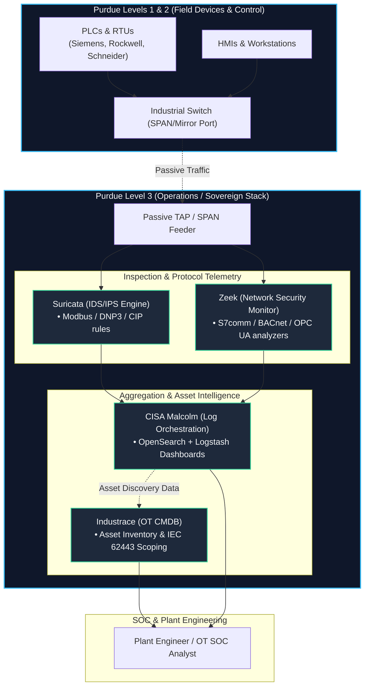

<div align="center">



# 🛡️ Awesome Operational Technology (OT) Management

<p align="center">
  <a href="https://github.com/ishandutta2007/Awesome-Awesome-Awesome"></a><a href="https://discord.gg/jc4xtF58Ve"></a>
  <a href="https://github.com/ishandutta2007/Awesome-Operational-Technology-OT-Management/stargazers"></a>
  <a href="https://github.com/ishandutta2007/Awesome-Operational-Technology-OT-Management/network/members"></a>
  <a href="https://github.com/ishandutta2007/Awesome-Operational-Technology-OT-Management/pulls"></a>
  <a href="https://github.com/ishandutta2007/Awesome-Operational-Technology-OT-Management/blob/main/LICENSE"></a>
  <a href="https://github.com/ishandutta2007"></a>
</p>

**A curated, SEO-indexed directory of leading SaaS platforms and open-source GitHub projects for Operational Technology (OT) Management, Cyber-Physical Systems (CPS) protection, and Industrial Control Systems (ICS) security.**

*Discover, inventory, monitor, and safeguard critical infrastructure across PLCs, RTUs, HMIs, SCADA networks, and converged IT/OT environments.*

</div>

---

## 📑 Table of Contents

- [🔍 Overview & Core Concepts](#-overview--core-concepts)
- [📊 Sector Overview & Market Dynamics](#-sector-overview--market-dynamics)
- [🏢 SaaS & Enterprise Platforms](#-saas--enterprise-platforms)
- [🌐 Open-Source GitHub Projects](#-open-source-github-projects)
- [🏗️ Sovereign Open-Source OT Architecture](#️-sovereign-open-source-ot-architecture)
- [📐 The Purdue Model & IT/OT Convergence](#-the-purdue-model--itot-convergence)
- [🤝 How to Contribute](#-how-to-contribute)
- [📈 Star History](#-star-history)
- [💖 Support & Sponsorship](#-support--sponsorship)
- [⚠️ Disclaimer](#️-disclaimer)

---

## 🔍 Overview & Core Concepts

**Operational Technology (OT)** encompasses hardware and software that detects or causes changes through the direct monitoring and control of physical equipment, industrial processes, and critical facilities. Unlike traditional Information Technology (IT)—where confidentiality is paramount—OT environments strictly prioritize **human safety, system availability, and deterministic physical reliability**.

This directory tracks solutions addressing the fundamental challenges of modern industrial operations:
- **Continuous Asset Discovery & Visibility:** Passive network sniffing (SPAN/TAP) and safe active querying to catalog Programmable Logic Controllers (PLCs), Remote Terminal Units (RTUs), Human-Machine Interfaces (HMIs), and Engineering Workstations without triggering plant trips.
- **OT Configuration Management (CMDB):** Establishing baseline configurations, tracking ladder logic changes, and maintaining accurate firmware revisions.
- **Vulnerability Prioritization & CVSS Correction:** Contextual risk scoring tailored to the Purdue Enterprise Reference Architecture (PERA), accounting for compensating physical controls.
- **Cyber-Physical Systems (CPS) Protection:** Anomaly detection across industrial fieldbus protocols (Modbus, S7comm, EtherNet/IP, DNP3, BACnet, OPC UA).
- **Compliance & Hardening:** Mapping controls to **IEC 62443**, **NIST SP 800-82**, **NERC CIP**, and **NIS2**.

---

## 📊 Sector Overview & Market Dynamics

The global **Operational Technology (OT) Security & Cyber-Physical Systems (CPS) Management** market is estimated at **$25.2 billion to $28.2 billion in 2026** and is projected to expand at a compound annual growth rate (**CAGR of 13.7% – 16.7%**), reaching between **$48 billion and $97 billion by 2031–2034**.

The sector exhibits **moderate fragmentation** rather than a winner-take-all monopoly:
- Enterprise hyperscalers and networking conglomerates (*Microsoft, Cisco, ServiceNow*) dominate IT/OT convergence layers and cloud telemetry.
- Specialized CPS security unicorns (*Armis, Claroty, Dragos, Nozomi Networks, Forescout*) capture high-value industrial threat detection, deep packet inspection, and proprietary protocol reverse-engineering.
- Automation OEMs (*Honeywell, Siemens, Schneider Electric*) embed protective controls directly into distributed control systems (DCS) and field hardware.
- High vendor heterogeneity, proprietary industrial protocols, zero-downtime constraints, and air-gapped critical infrastructure prevent monopolistic consolidation, driving sustained demand for both interoperable SaaS platforms and self-hosted open-source tooling.

---

## 🏢 SaaS & Enterprise Platforms

The following table details enterprise SaaS and commercial platforms for OT management and CPS protection. **Sorted descending by Company Size (Market Capitalization or Private Market Valuation).**

| 🏢 Platform & Vendor | 📈 Company Size (Market Cap / Valuation) | 🎯 Key Capabilities & OT Focus | 💳 Starting Tier Pricing | 🎁 Free Tier / Trial Limits |
| :--- | :--- | :--- | :--- | :--- |
| **[Microsoft Defender for IoT](https://azure.microsoft.com/en-us/products/iot-defender)** | **~$3.12 Trillion** *(Market Cap)*<br>~$245B Ann. Rev. | Agentless network-layer monitoring for OT/ICS, specialized protocol identification, machine learning risk assessment, and native Microsoft Sentinel SIEM/SOAR/XDR integration. | **$150.00 / month** ($1,800/yr billed annually) for Extra Small (XS) OT site license (covers up to 100 devices); Enterprise IoT add-on starts at **$3.30 / device / month**. | **30-day free trial** with full features enabled for up to **1,000 committed devices**; Enterprise IoT includes **5 devices free** per Microsoft 365 E5 license. |
| **[Cisco Cyber Vision](https://www.cisco.com/site/us/en/products/security/industrial-security/cyber-vision/index.html)** | **~$230 Billion** *(Market Cap)*<br>~$54B Ann. Rev. | Built into Cisco industrial network hardware; decodes 100+ industrial protocols, calculates risk scores, identifies silent field assets, and enforces segmentation via Cisco ISE. | **$350.00 – $495.00 / year** list baseline for entry 25-endpoint Cyber Vision Essentials package (~$14–$20/endpoint/yr); scales to ~$2,500/yr for 500 endpoints. | **90-day built-in evaluation mode** with complete operational capabilities; select Cisco IE3500/IE9300 industrial switches include a bundled **3-year, 24-endpoint** Advantage license. |
| **[ServiceNow OT Management](https://www.servicenow.com/products/operational-technology-management.html)** | **~$185 Billion** *(Market Cap)*<br>~$10.5B Ann. Rev. | Unified industrial workspace on the Now Platform; OT CMDB convergence, firmware lifecycle tracking, and automated OT incident/change/vulnerability response workflows. | **$10,000 – $15,000 / year** entry baseline platform contract (~$150–$200/fulfiller user/month plus ~$50/monitored node/yr for ITOM/OTM modules). | **Perpetual Free Personal Developer Instance (PDI)** via ServiceNow Developer Program (full platform access, hibernates after 10 days inactivity); 30-day enterprise PoC sandbox. |
| **[Honeywell Forge Cybersecurity+](https://process.honeywell.com/us/en/products/software/cybersecurity)** *(incl. SCADAfence)* | **~$135 Billion** *(Market Cap)*<br>~$38B Ann. Rev. | Continuous OT network monitoring, asset discovery, and governance; deep inspection across large-scale distributed plant networks with Forge Cyber Watch enterprise aggregation. | **$15,000.00 / year** baseline subscription for single-facility Cyber Insights deployment (covers up to 250 industrial assets). | **30-day guided Proof of Concept (PoC)** and OT Cyber Risk Assessment for 1 production facility (up to 250 connected industrial devices). |
| **[Tenable OT Security](https://www.tenable.com/products/tenable-ot)** *(formerly Tenable.ot)* | **~$5.2 Billion** *(Market Cap)*<br>~$860M Ann. Rev. | 360-degree visibility across converged IT/OT surfaces; safe active querying using native controller protocols, predictive prioritization, and snapshot-based ladder logic tracking. | **$3,700 – $4,800 / year** baseline subscription for entry tier (licensed per asset bracket, typically $25–$35/asset/year starting at 100 assets). | **30-day guided evaluation / PoC** covering up to **250 OT assets** with 1 network sensor instance and vulnerability reporting. |
| **[Armis Centrix™](https://www.armis.com/platform/armis-centrix/)** | **~$4.3 Billion** *(Valuation)*<br>~$200M+ ARR | Agentless cyber exposure management; Attack Path Mapping, digital twin behavioral simulations, zero-trust remote access, and air-gapped on-premise sensor architectures. | **$3,250.00 / month** ($39,000/yr billed annually) baseline cloud entry tier; UK G-Cloud lists base software instances starting at **£3,100 / instance**. | **30-day guided Proof of Concept (PoC)** and cyber risk exposure assessment covering up to **1,000 networked OT/IoT assets**. |
| **[Claroty xDome](https://claroty.com/xdome)** | **~$2.5 Billion** *(Valuation)*<br>~$160M+ ARR | Cloud-native CPS protection platform; agentless asset discovery, real-time vulnerability scoring, network communication mapping, and automated IEC 62443 zone segmentation. | **£25.00 (~$32.50) / asset / year** for xDome Essentials software tier; entry packaged site tier begins at **£12,000 (~$15,500) / year** (covers up to 300 assets). | **14 to 30-day guided Proof of Concept (PoC)** and Rapid Risk Assessment for 1 operational facility (up to 250 connected OT devices). |
| **[Forescout Technologies](https://www.forescout.com/)** | **~$1.9 Billion** *(Valuation)*<br>~$350M+ Ann. Rev. | Continuous multi-factor risk assessment, zero-trust network segmentation, and automated policy enforcement spanning converged IT, OT, IoT, and IoMT environments. | **$12,500 – $18,000 / year** entry FLEXX subscription tier (priced per endpoint at ~$12–$25/endpoint/yr in blocks of 500–1,000 endpoints). | **30-day enterprise Proof of Concept (PoC)** license supporting up to **500 endpoints** for network discovery and policy simulation. |
| **[Dragos Platform](https://www.dragos.com/platform/)** | **~$1.7 Billion** *(Valuation)*<br>~$120M+ ARR | OT-native threat intelligence, 600+ industrial protocol dissectors, "Now, Next, Never" OT-corrected CVSS vulnerability prioritization, and Neighborhood Keeper collective defense. | **$4,500.00 / year** baseline for single low-bandwidth sensor subscription (100 Mbps throughput tier); enterprise CentralStore cloud lists at **$100,000 / year** (up to 50 SiteStores). | **30-day guided Proof of Concept (PoC)** and Industrial Threat Assessment for 1 industrial site or lab environment (up to 2 sensors). |
| **[Nozomi Networks Vantage](https://www.nozominetworks.com/products/vantage)** | **~$1.1 Billion** *(Valuation)*<br>~$110M+ ARR | Cloud-managed OT/IoT security console with Vantage IQ AI assistant; passive network sensors, multi-factor risk scoring at asset/zone levels, and Nozomi Labs threat intel feeds. | **$22,000.00 / year** entry Vantage cloud bundle (covering up to 500 assets at ~$44/asset/yr with unlimited Guardian VM sensors; AWS T5K bundle lists at $218,880/year for 5,000 assets). | **30-day full-featured trial** and guided Proof of Concept for Vantage cloud covering up to **250 assets** and 1 Guardian VM sensor. |
| **[TXOne Networks](https://www.txone.com/)** | **~$650 Million** *(Valuation)*<br>$120M+ Raised | Operations-first OT security; Stellar Protect for legacy/modern industrial endpoints (Windows 2000 to Windows 11) and Edge inline industrial firewalls with virtual patching. | **$45.00 – $65.00 / endpoint / year** for Stellar Protect (packs of 100+ endpoints); Edge series inline hardware/software appliance subscriptions start at **~$3,500 / year**. | **90-day (3-month) free assessment license** for enterprise partner evaluations and site readiness audits (up to 50 endpoints). |

---

## 🌐 Open-Source GitHub Projects

Open-source tooling enables plant engineers, security researchers, and ICS defenders to build sovereign, self-hosted OT visibility stacks without per-asset licensing costs.

The table below lists top open-source projects for OT packet analysis, protocol decoding, honeypots, CMDB, and compliance. **Sorted descending by GitHub Star Count.**

| 💻 Project | ⭐ Stars *(White Social Badge)* | 🏷️ Category & Focus | 📜 License | 📝 Summary & OT Capabilities |
| :--- | :--- | :--- | :--- | :--- |
| **[Scapy](https://github.com/secdev/scapy)** | [](https://github.com/secdev/scapy/stargazers) | Packet Manipulation & Industrial Protocols | GPL-2.0 | Powerful Python-based interactive packet manipulation engine with native dissectors and builders for Modbus, DNP3, CIP, IEC 60870-5-104, and Profinet. |
| **[Zeek](https://github.com/zeek/zeek)** | [](https://github.com/zeek/zeek/stargazers) | Network Security Monitoring & Telemetry | BSD-3-Clause | Deep network analysis framework with specialized protocol analyzers for industrial protocols (Modbus, DNP3, S7comm, BACnet) generating structured transaction logs. |
| **[Suricata](https://github.com/OISF/suricata)** | [](https://github.com/OISF/suricata/stargazers) | Network IDS / IPS & Threat Detection | GPL-2.0 | High-performance intrusion detection engine with native keywords for industrial protocols like Modbus, DNP3, and Enip/CIP, capable of inspecting anomalous PLC command sequences. |
| **[open62541](https://github.com/open62541/open62541)** | [](https://github.com/open62541/open62541/stargazers) | OPC Unified Architecture (IEC 62541) | MPL-2.0 | Open-source C99 implementation of OPC UA (IEC 62541); provides secure, interoperable industrial middleware communication across sensors, actuators, and SCADA hosts. |
| **[PyModbus](https://github.com/pymodbus-dev/pymodbus)** | [](https://github.com/pymodbus-dev/pymodbus/stargazers) | Industrial Protocol Stack (Modbus) | BSD-3-Clause | Complete asynchronous Python implementation of Modbus protocol (TCP, RTU, ASCII, TLS); ideal for building OT security testing tools, testbeds, and custom telemetry agents. |
| **[Malcolm](https://github.com/cisagov/Malcolm)** | [](https://github.com/cisagov/Malcolm/stargazers) | Cyber Traffic Analysis Suite (CISA) | CC0-1.0 | CISA's flagship cyber traffic analysis suite combining Zeek, Suricata, and OpenSearch with dedicated parsers and dashboards designed specifically for ICS/OT networks. |
| **[ICS-Security-Tools](https://github.com/ITI/ICS-Security-Tools)** | [](https://github.com/ITI/ICS-Security-Tools/stargazers) | Security Tooling & Scripts | MIT | Curated collection of scripts, utilities, protocol scanners, and test suites maintained by ITI for auditing industrial control systems and SCADA networks. |
| **[OpenSCAP](https://github.com/OpenSCAP/openscap)** | [](https://github.com/OpenSCAP/openscap/stargazers) | Compliance & Hardening | LGPL-2.1 | NIST-certified SCAP 1.2 toolkit providing automated vulnerability scanning and security baseline evaluation applicable to industrial engineering workstations and OT gateways. |
| **[OpenPLC Runtime](https://github.com/thiagoralves/OpenPLC_v3)** | [](https://github.com/thiagoralves/OpenPLC_v3/stargazers) | Functional Soft-PLC & ICS Testbed | GPL-3.0 | Fully functional IEC 61131-3 compliant soft-PLC runtime; standard platform for building virtual ICS cyber ranges, security testing ladder logic, and hardware-in-the-loop tests. |
| **[Conpot](https://github.com/mushorg/conpot)** | [](https://github.com/mushorg/conpot/stargazers) | ICS / SCADA Honeypot | GPL-2.0 | Low-to-medium interaction industrial honeypot designed to emulate complex control systems, PLCs (Siemens S7-300), Modbus slaves, BACnet devices, and IPMI interfaces. |
| **[ISF Framework](https://github.com/dark-lbp/isf)** | [](https://github.com/dark-lbp/isf/stargazers) | ICS Exploitation & Assessment | GPL-3.0 | Modular Python framework styled like Metasploit focused exclusively on Industrial Control Systems, featuring modules for Schneider, Siemens, and Rockwell PLCs. |
| **[gopcua](https://github.com/gopcua/opcua)** | [](https://github.com/gopcua/opcua/stargazers) | Native Go OPC UA Library | MIT | High-performance native Go implementation of the OPC UA specification, suitable for building lightweight cross-platform OT monitoring agents and edge collectors. |
| **[GRASSMARLIN](https://github.com/nsacyber/GRASSMARLIN)** | [](https://github.com/nsacyber/GRASSMARLIN/stargazers) | ICS Situational Awareness (NSA) | Apache-2.0 | Developed by the NSA to passive map and generate situational awareness of industrial control networks, visualizing Purdue model tiers and device interconnections. |
| **[python-snap7](https://github.com/gijzelaerr/python-snap7)** | [](https://github.com/gijzelaerr/python-snap7/stargazers) | Siemens S7 Communication Library | MIT | Python wrapper for Snap7; communicates directly with Siemens S7-300/400/1200/1500 PLCs over ISO-on-TCP (RFC 1006) for telemetry extraction and authorized security audits. |
| **[Arya](https://github.com/claroty/arya)** | [](https://github.com/claroty/arya/stargazers) | Reverse YARA & Rule Testing | Apache-2.0 | Claroty Team82 tool that generates pseudo-malicious files designed to trigger YARA rules, assisting industrial defenders in validating detection signatures safely. |
| **[Industrace](https://github.com/Industrace/industrace)** | [](https://github.com/Industrace/industrace/stargazers) | Open-Source OT/ICS CMDB | AGPL-3.0 | Modern open-source configuration management database purpose-built for OT; tracks PLCs, HMIs, sensors, network topology, IEC 62443 scopes, and distributed discovery probes. |

---

## 🏗️ Sovereign Open-Source OT Architecture

Organizations seeking complete control over their industrial telemetry can construct an on-premise, zero-license OT management stack using open-source components:



---

## 📐 The Purdue Model & IT/OT Convergence

Operational Technology management relies on the **Purdue Enterprise Reference Architecture (PERA)** (ANSI/ISA-95) to segment network operations and restrict lateral movement:

```
[Level 5] Enterprise Network    -> Corporate ERP, Email, Cloud Analytics
   ▲
   │ Inter-Zone Firewall / Demilitarized Zone (IDMZ - Level 3.5)
   ▼
[Level 4] Site Business Systems -> Plant Scheduling, MES, Asset Performance Mgmt
[Level 3] Site Operations      -> Historians, OT CMDB, Engineering Workstations
[Level 2] Supervisory Control   -> HMIs, SCADA Consoles, Operator Interfaces
[Level 1] Basic Control        -> PLCs, RTUs, DCS Controllers, Safety Instrumented Systems (SIS)
[Level 0] Physical Process      -> Pumps, Motors, Actuators, Sensors, Flow Meters
```

### 🛡️ Critical Security Mandates in OT
1. **Never Disrupt deterministic operations:** Unsolicited active IP scanning (e.g., standard Nmap or Nessus default templates) can overwhelm legacy PLC microcontrollers and crash factory lines.
2. **Prioritize Safety & Availability:** Confidentiality breaches are secondary to equipment integrity and physical human safety.
3. **Firmware & Change Tracking:** Maintain verified snapshots of controller ladder logic and firmware versions to counter unauthorized changes or supply-chain attacks.

---

## 🤝 How to Contribute

We welcome additions, corrections, and improvements from OT engineers, SCADA architects, and cybersecurity researchers!

1. **Fork the Repository** on GitHub.
2. **Review Formatting Guidelines:**
   - For SaaS tools: include verified starting tier pricing, free trial specifications, and company size metrics.
   - For Open-Source tools: include official repo link, social star badge, license, and concise technical description.
3. **Submit a Pull Request (PR)** with a clear explanation of your change.

Explore more curated lists at [Awesome-Awesome-Awesome](https://github.com/ishandutta2007/Awesome-Awesome-Awesome)!

---

## 📈 Star History

[](https://star-history.dera.page/#ishandutta2007/Awesome-Operational-Technology-OT-Management&type=date&legend=top-left)

---

## 💖 Support & Sponsorship

Thank you for exploring and utilizing this curated Operational Technology resource! If this project helps simplify your OT asset management, ICS hardening, or architecture evaluations, please consider supporting its ongoing development:

- ⭐ **Star this repository** to improve visibility for industrial defenders worldwide.
- 🍴 **Fork and share** the project across your engineering teams and communities.
- 📢 **Spread the word** on LinkedIn, Reddit, or your favorite ICS/OT forums.
- ☕ **Support the maintainer:** Buy a coffee or become a sponsor via the [GitHub Sponsor Dashboard](https://github.com/sponsors/ishandutta2007).

---

## ⚠️ Disclaimer

- This repository is a **community-curated index** provided for informational and educational purposes only; inclusion does not constitute commercial endorsement.
- Operational Technology environments govern high-consequence physical systems (energy grids, water treatment, chemical manufacturing, transportation). Always execute safety risk assessments before introducing new network monitoring sensors or scanning scripts into production facilities.
- Verify software license terms before commercial deployment (e.g., AGPL-3.0 for Industrace, GPL-2.0/3.0 for Suricata, Conpot, and OpenPLC).
